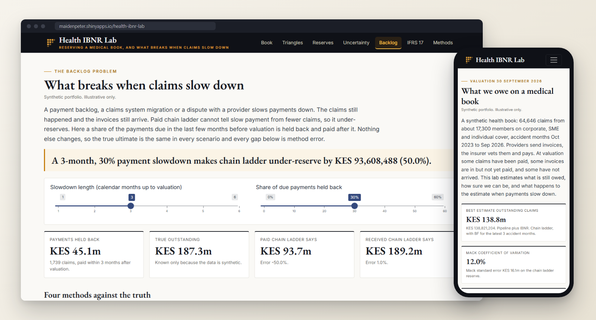
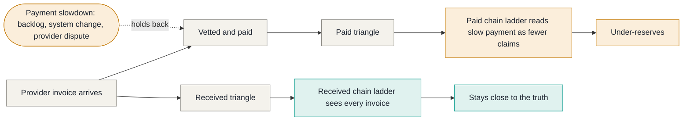
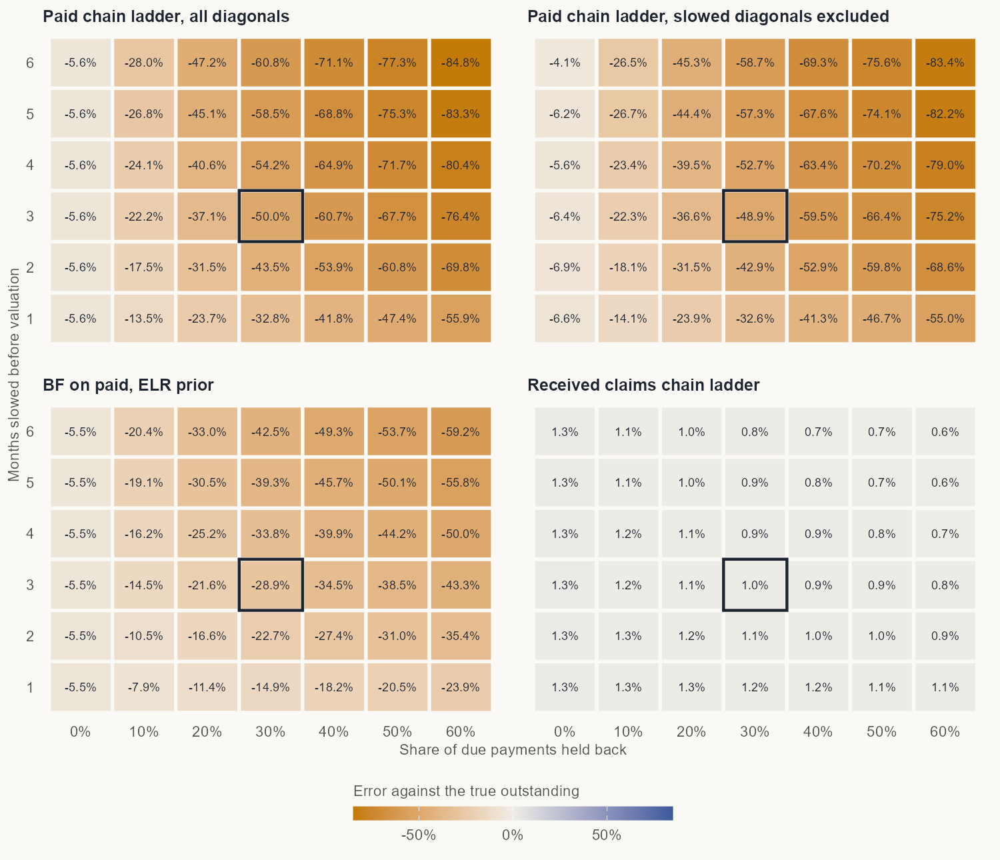
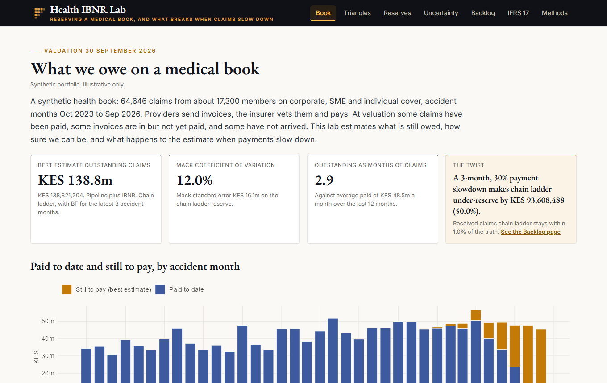
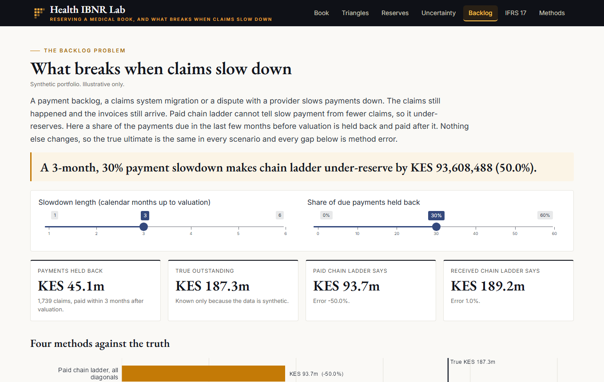
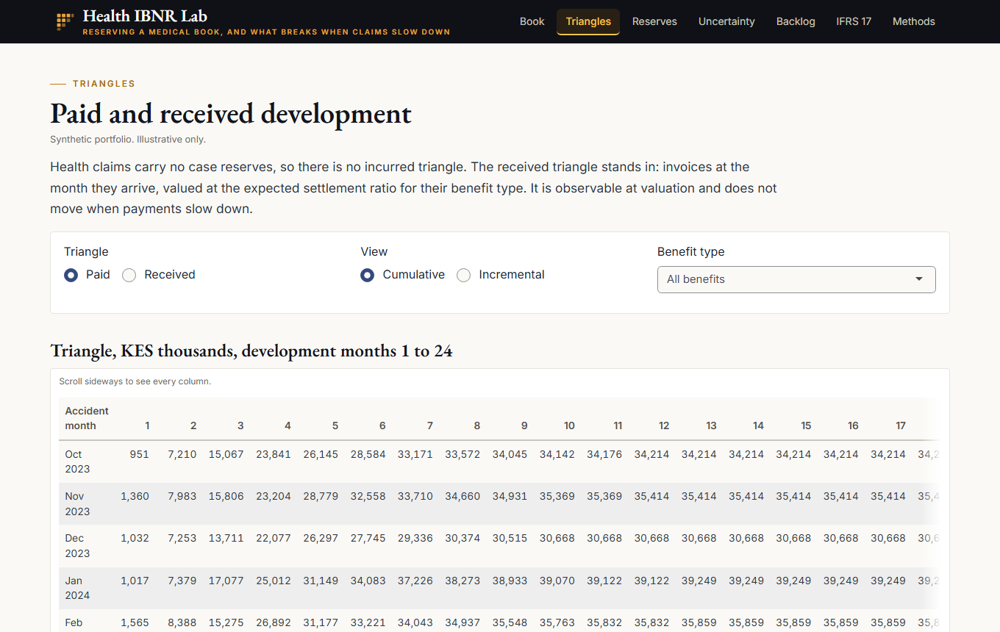
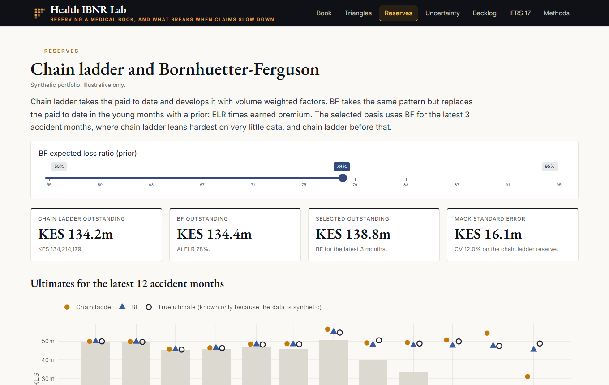
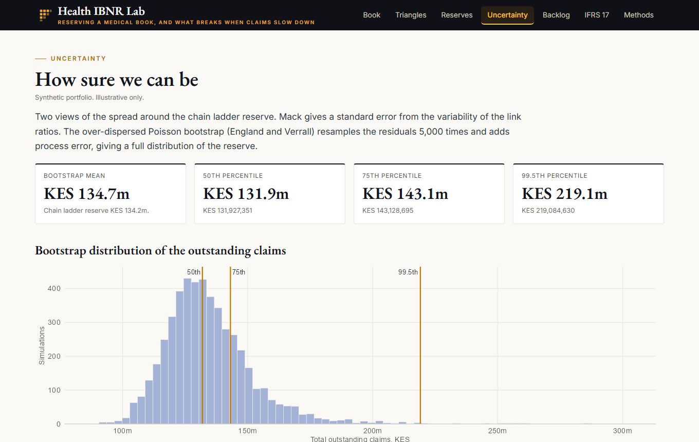
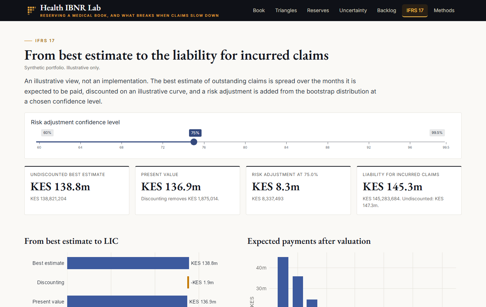
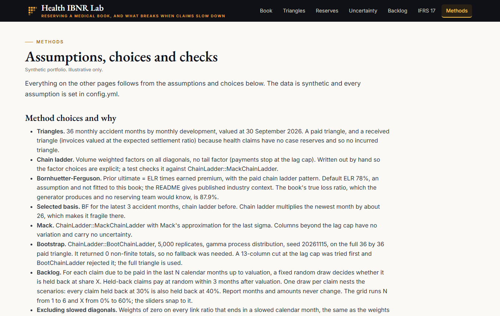

<p align="center">
  
</p>

<h1 align="center">Health IBNR Lab</h1>

<p align="center">
  <b>How much we owe on health claims, how sure we are, and what breaks the estimate.</b><br>
  Reserving a synthetic medical book in R, then watching chain ladder fail when claims slow down.
</p>

<p align="center">
  <a href="https://maidenpeter.shinyapps.io/health-ibnr-lab/"></a>
  
  
  
  
</p>

<p align="center">
  <a href="https://maidenpeter.shinyapps.io/health-ibnr-lab/"><b>Open the live app</b></a>
  &nbsp;&middot;&nbsp; <a href="#what-the-backlog-test-found">What it found</a>
  &nbsp;&middot;&nbsp; <a href="#how-it-works">How it works</a>
  &nbsp;&middot;&nbsp; <a href="#run-it-locally">Run it locally</a>
</p>

<p align="center">
  <a href="https://maidenpeter.shinyapps.io/health-ibnr-lab/"></a>
</p>

<p align="center"><sub>The app runs on the shinyapps.io free plan (up to 5 apps and 25 active hours a month), so it sleeps when nobody is using it and takes a few seconds to wake.</sub></p>

## The answer

<table>
  <tr>
    <td align="center" valign="top" width="33%"><h3>KES 138.8m</h3>best estimate outstanding<br><sub>pipeline plus IBNR at 30 September 2026</sub></td>
    <td align="center" valign="top" width="33%"><h3>12.0%</h3>Mack coefficient of variation<br><sub>bootstrap 99.5th percentile KES 219.1m</sub></td>
    <td align="center" valign="top" width="33%"><h3>-50.0%</h3>paid chain ladder error<br><sub>3 months, 30% of payments held back</sub></td>
  </tr>
</table>

> [!IMPORTANT]
> **A 3-month, 30% payment slowdown makes chain ladder under-reserve by KES 93,608,488 (50.0%).** A chain ladder on received claims, which do not slow down, stays within 1.0% of the truth.

This is a synthetic medical book of 64,646 claims over 36 accident months, October 2023 to September 2026. On it, the lab estimates what is still owed, measures how sure that estimate is, and turns it into an IFRS 17 liability for incurred claims. Then it breaks the estimate on purpose, to see which reserving methods notice.

## How a slowdown fools the reserve

Health claims arrive as provider invoices. They are vetted, then paid. A paid chain ladder only sees the payments. So when payments slow down, because of a backlog, a claims system migration or a dispute with a provider, it reads the slowdown as fewer claims. It then multiplies the short latest diagonal by its development factors. The invoices still arrive, so a chain ladder on received claims does not move.



## What the backlog test found

A share of the payments due in the last few months before valuation is held back and paid after it. Report months and amounts do not change, so the true ultimate is the same in every scenario, and every gap is method error.

<p align="center"></p>

Each square is one scenario, 42 in all: 1 to 6 months slowed, 0% to 60% of due payments held back. The outlined square is the default (3 months, 30%). Amber means under-reserved. In the far corner paid chain ladder is 84.8% short. Excluding the slowed diagonals barely changes that (83.4% short), and BF on paid is still 59.2% short. The received claims chain ladder's error stays between 0.6% and 1.3% in every scenario. Even with nothing held back, paid chain ladder starts 5.6% short at this valuation.

For the default slowdown (3 months, 30% of due payments held back, KES 45,065,584 of payments):

| Method | Error against the true outstanding |
|---|---|
| Paid chain ladder, all diagonals | -50.0% |
| Paid chain ladder, slowed diagonals excluded | -48.9% |
| Received claims chain ladder | 1.0% |
| BF on paid, ELR prior | -28.9% |

- **Excluding the slowed diagonals barely helps.** Of the KES 93,608,488 shortfall, KES 45,065,584 is payments that slipped past valuation and KES 37,555,979 is chain ladder multiplying that gap by its development factors. Wrong factors account for only KES 2,978,482. Excluding the slowed diagonals fixes the factors, not the short latest diagonal. We expected it to help more.
- **BF helps but does not fix it.** BF does not multiply the gap, but it cannot see it either.
- **The received claims chain ladder sees through it**, because received claims do not slow down.
- **Paid chain ladder can pass its own back-test while it is badly short.** Holding out the latest month, its actual against expected is 104.3% with the slowdown (and 111.4% without), because the slowdown depresses the forecast and the actual together. The received claims chain ladder's A/E is 78.1%, which does flag it.
- **The early warnings work.** The pipeline of received but unpaid claims rises to 3.9 months of paid claims against 1.8 without the slowdown, and an actual against expected heatmap anchored on received claims shows the slowed months as a cold band.

## Tour of the app

Seven pages. Click any picture to see the whole page.

<table>
  <tr>
    <td width="50%" valign="top"><a href="assets/screenshots/1-book.png"></a><br><b>Book.</b> The portfolio, the valuation date and the headline cards.</td>
    <td width="50%" valign="top"><a href="assets/screenshots/5-backlog.png"></a><br><b>Backlog.</b> The slowdown sliders, four methods against the truth, the early warnings and the back-test.</td>
  </tr>
  <tr>
    <td width="50%" valign="top"><a href="assets/screenshots/2-triangles.png"></a><br><b>Triangles.</b> Paid and received triangles, development factors and a link ratio heatmap.</td>
    <td width="50%" valign="top"><a href="assets/screenshots/3-reserves.png"></a><br><b>Reserves.</b> Chain ladder and BF side by side, with a live ELR slider.</td>
  </tr>
  <tr>
    <td width="50%" valign="top"><a href="assets/screenshots/4-uncertainty.png"></a><br><b>Uncertainty.</b> Mack standard errors and the ODP bootstrap distribution of the outstanding claims.</td>
    <td width="50%" valign="top"><a href="assets/screenshots/6-ifrs17.png"></a><br><b>IFRS 17.</b> From best estimate to LIC, with a live confidence level slider.</td>
  </tr>
  <tr>
    <td colspan="2" align="center"><a href="assets/screenshots/7-methods.png"></a><br><b>Methods.</b> Every assumption, every method choice, the limitations and the test results.</td>
  </tr>
</table>

## Why health IBNR matters

Medical cover is the largest class of general insurance in Kenya. Industry figures for 2025 put medical premiums at KES 93.20bn, up 22.3% on the year ([Capital FM](https://capitalfm.africa/nairobi-mombasa-and-kiambu-account-for-most-insurance-premiums/), [KBC](https://www.kbc.co.ke/microinsurance-posts-fastest-premium-growth-to-reach-ksh-2-17b/), both reporting Insurance Regulatory Authority data). Medical claims ratios run high: press coverage of the IRA's second quarter 2025 release put the medical loss ratio at 81%, against 73% for the industry ([Eastleigh Voice](https://eastleighvoice.co.ke/business/216146/insurance-sector-profits-slide-as-claims-soar-by-sh17-billion); [IRA Q2 2025 release](https://www.ira.go.ke/lib.html?f=quarter-2-2025-industry-release)).

Health claims are short tail, but they arrive as provider invoices with no case reserves, and they are paid after vetting. The reserve at any month end is mostly invoices in the pipeline and claims not yet received. Small changes in how fast claims are paid move it a lot.

The data here is synthetic, generated from the assumptions in [config.yml](config.yml). No insurer's data, name or branding is used. The industry figures above are context only; the BF prior in this lab (78%) is an assumption and is not fitted to them or to the book. The book's true loss ratio, which the generator produces and no reserving team would know, is 87.9%.

## How it works

- **Triangles.** 36 monthly accident months, October 2023 to September 2026, by monthly development. A paid triangle, and a received triangle (invoices valued at the expected settlement ratio for their benefit type) that stands in for the incurred triangle a health book does not have.
- **Chain ladder, Mack, Bornhuetter-Ferguson.** Volume weighted chain ladder, checked against `ChainLadder::MackChainLadder`. BF with prior ELR times earned premium. The selected basis uses BF for the latest 3 accident months, where paid chain ladder multiplies the newest month by about 26. Mack standard error KES 16,122,375.
- **Bootstrap.** Over-dispersed Poisson bootstrap (`ChainLadder::BootChainLadder`, 5,000 replicates). 75th percentile KES 143,128,695, 99.5th percentile KES 219,084,630.
- **The backlog test.** A grid of 1 to 6 months slowed and 0% to 60% of due payments held back, with the same claims in every scenario.
- **IFRS 17 view.** The best estimate spread over its expected payment months, discounted on an illustrative curve (KES 136,946,191 present value), plus a risk adjustment at the 75.0% confidence level (KES 8,337,493), giving a liability for incurred claims of KES 145,283,684. Illustrative, not an implementation.

<details>
<summary><b>Why a received triangle, and not an incurred one</b></summary>

A health book has no case reserves, so there is no incurred triangle. Each invoice is recorded when it arrives, valued at the expected settlement ratio for its benefit type. That is what an incurred triangle would be if every case estimate were set at the expected settlement ratio. Received but not yet paid is the pipeline, KES 89,804,565 at valuation, which is why the outstanding is labelled pipeline plus IBNR.

</details>

<details>
<summary><b>Why excluding the slowed diagonals is not enough</b></summary>

A slowdown hurts paid chain ladder twice. Link ratios that cross the slowed months are too low, and the latest diagonal itself is short and then multiplied by the development factor. Dropping the slowed diagonals from factor selection fixes only the first. In the default scenario the factors account for KES 2,978,482 of a KES 93,608,488 shortfall.

</details>

<details>
<summary><b>How the bootstrap was set up</b></summary>

`ChainLadder::BootChainLadder` needs at least as many origin periods as development periods, so it runs on the full 36 by 36 monthly paid triangle: 5,000 replicates, gamma process distribution, fixed seed. The late development columns are close to zero, and every replicate came back finite. The bootstrap mean is 0.3% away from the chain ladder reserve.

</details>

<details>
<summary><b>What the IFRS 17 page does, and does not do</b></summary>

The discount curve is illustrative, not a published curve. Most of these claims are paid within a year, so under the premium allocation approach IFRS 17 paragraph 59(b) allows an entity not to discount them. The page shows the discount effect anyway (KES 1,875,014), so the reader sees why that option exists. The risk adjustment is a percentile of the bootstrap minus its mean, at a disclosed confidence level (paragraph 119). No diversification, no reinsurance and no claims handling expenses.

</details>

## What I would do with real data

- Use case reserves where the claims system has them, and reconcile the received triangle to the claims system's pipeline of invoices.
- Add claims handling expenses, and reinsurance where it applies.
- Check the data before any triangle: duplicates, reversals, date errors, claims paid before they were reported, large claims, and changes in benefit mix.
- Watch payment speed every month (pipeline, A/E against received) before choosing factors, and talk to the claims team when it moves.
- Document the selections, review them with a second actuary, and take them through sign-off.

## Inside the repo

```
app.R                     the Shiny app; it only reads precomputed results
R/                        generator, triangles, methods, backlog, IFRS 17, formatting
config.yml                every assumption, each with a one line comment
scripts/build_results.R   generates the data, runs every method and the tests
scripts/render_readme.R   fills in this README and draws its figure
scripts/readme_images.R   takes the README's pictures of the running app
data/                     claims, results, headline numbers and test results
tests/testthat/           reconciliation, method, backlog, headline and hygiene tests
```

## Run it locally

```r
renv::restore()
source("scripts/build_results.R")   # generates the data, runs every method and the tests, about a minute
shiny::runApp()
```

Tests: 17 of 17 pass (`data/test_results.csv`). Every number in this README is filled in from `data/headline.json` and `data/test_results.csv` by `scripts/render_readme.R`.

## Why I built this

As a reserving analyst I ran IBNR for health, motor and non-motor books. I built the triangles in R and passed the IFRS 17 inputs on to the calculation engine. Health is the class where the reserve depends most on how fast claims get paid. The claims are short tail, so the reserve looks simple. But there are no case reserves, and what you owe at month end is mostly invoices waiting to be paid and claims that have not arrived yet.

That is the question behind this lab. If payments slow down for a few months, because of a backlog, a system change or a dispute with a provider, a paid chain ladder reads it as fewer claims. I wanted to measure what that costs, which of the usual fixes work, and what an analyst should watch before the reserve moves. The result I did not expect: excluding the slowed months barely helps.

I built it on synthetic data so every number can be shared, and in R because that is where I did this work. The IFRS 17 page stops at the inputs a calculation engine needs: the cash flows, the discount curve and the risk adjustment.

---

<p align="center"><sub>Synthetic portfolio. Illustrative only. No insurer's data, name or branding is used.<br>
Built by Marion Peter. Also by me: <a href="https://github.com/maidenpeter/instalment-persistency-lab">Instalment Persistency Lab</a>, lapse and anti-selection on instalment health cover, in Python and SQL.</sub></p>
